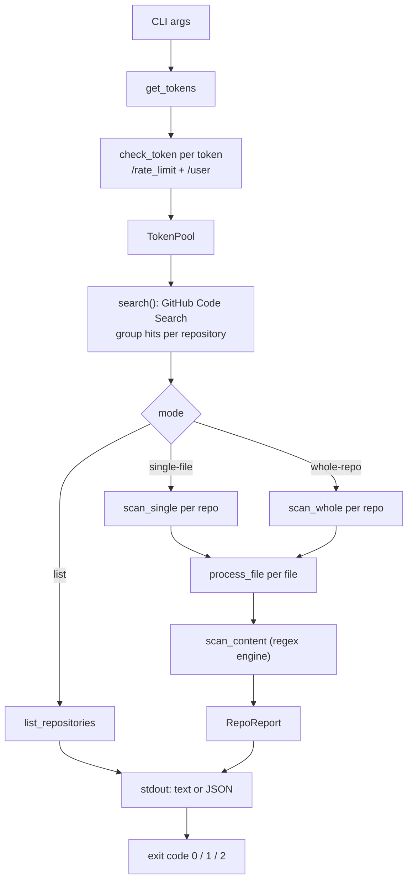
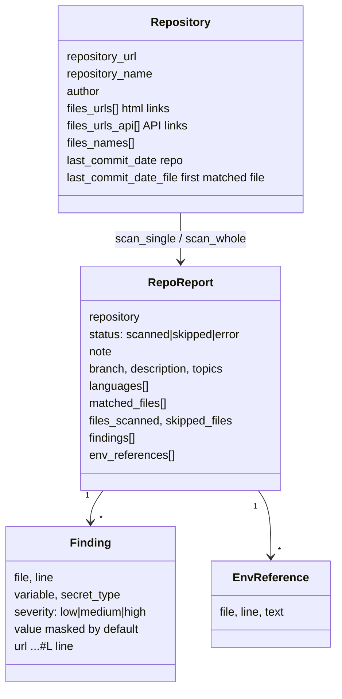
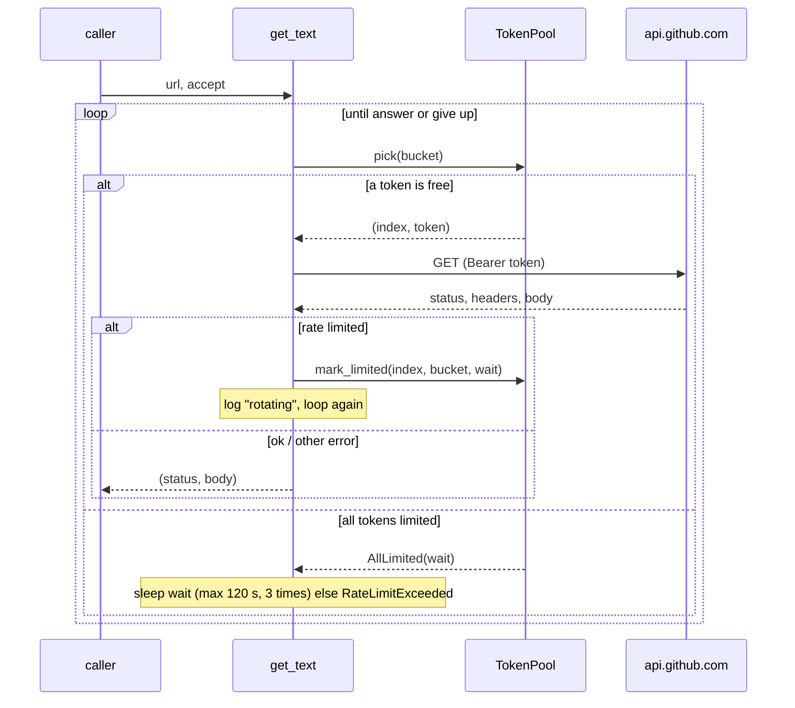

# Galgo: technical documentation

This document explains how Galgo works internally: the pipeline, the modules,
the data model, the detection engine, the GitHub API layer (rate limits and
token rotation), the output contract, and how to extend it. For usage, see the
[README](../README.md). For what changed in the latest refactor, see
[CHANGELOG_IMPROVEMENTS.md](../CHANGELOG_IMPROVEMENTS.md).

- [1. Overview](#1-overview)
- [2. Source layout](#2-source-layout)
- [3. Execution pipeline](#3-execution-pipeline)
- [4. Data model](#4-data-model)
- [5. Search stage](#5-search-stage)
- [6. Scan stage](#6-scan-stage)
- [7. Detection engine](#7-detection-engine)
- [8. GitHub API layer](#8-github-api-layer)
- [9. Tokens and rotation](#9-tokens-and-rotation)
- [10. Output contract](#10-output-contract)
- [11. Concurrency model](#11-concurrency-model)
- [12. Extending Galgo](#12-extending-galgo)
- [13. Testing](#13-testing)
- [14. Known limitations](#14-known-limitations)

---

## 1. Overview

Galgo answers one question: *which public GitHub code mentions my domain, and
does any of it leak credentials?*

It is a single async Rust binary (`tokio` + `reqwest`) with three modes:

| Mode | Flag | What it does |
|------|------|--------------|
| single-file | `-s` | Scans only the files returned by the code search |
| whole-repo | `-w` | Scans every config-like file of each matching repository |
| list | `-l` | Lists repositories and matching files, no scanning |

All three share the same first stage (search). The scan modes then share one
detection engine and one reporting layer.

## 2. Source layout

```
src/
├── main.rs                  CLI definition (clap), startup, exit codes
├── token.rs                 Token loading, TokenPool (rotation), describe_token
└── github/
    ├── mod.rs               Re-exports
    ├── github.rs            HTTP client, rate limits, search, API wrappers,
    │                        Repository / RepoMetadata / HttpErrorCounter
    ├── secret_detection.rs  scan_content, Finding, RepoReport, run_scan,
    │                        printing, list mode
    └── utils.rs             URL/path helpers, box-drawing helpers
patterns.json                Detection patterns, embedded at compile time
```

| File | Key items |
|------|-----------|
| `main.rs` | `Args` (`SearchConfig`, `AnalysisModes`, `OutputConfig`), `main()`: mode selection, token check, search, dispatch |
| `token.rs` | `get_tokens`, `parse_tokens`, `TokenPool`, `Bucket`, `Pick` |
| `github.rs` | `CLIENT`, `get_text`, `get_json`, `search`, `check_token`, `get_repo_metadata`, `get_repo_files_recursive`, `get_file_content_by_sha`, `get_raw_file_content_from_api`, `get_repo_languages`, `should_scan_repository` |
| `secret_detection.rs` | `PATTERNS`, `EXCLUSION_PATTERNS`, `scan_content`, `scan_single`, `scan_whole`, `process_file`, `run_scan`, `print_report`, `print_findings_summary`, `list_repositories` |
| `utils.rs` | `clean_url`, `extract_file_path`, `filter_files_by_extension`, `create_box_*` |

## 3. Execution pipeline



`main()` in order:

1. Parse arguments. No mode → print help, exit `2`.
2. Disable colors if `--no-color` or stdout is not a terminal.
3. `get_tokens()` → validate each token with `check_token()` → build the `TokenPool`.
4. `search()` → `HashMap<repo_url, Repository>` plus the shared `HttpErrorCounter`.
5. Dispatch to `list_repositories` or `run_scan`.
6. Exit `1` if `run_scan` returned more than 0 findings.

## 4. Data model



- `Repository` is the output of the search stage. `files_urls` and
  `files_urls_api` are parallel vectors: index *i* is the same file.
- `RepoReport` is the output of the scan stage and is also the JSON schema
  (it derives `Serialize`). Printing never mutates it.
- `HttpErrorCounter` (atomic counters per status code) is cloned into every
  task and printed once at the end.

## 5. Search stage

`search()` in `github.rs`.

1. **Query.** `domain`, plus `extension:a OR extension:b` when `--include-ext` is
   given. Requested through `GET /search/code?per_page=100&page=N`.
2. **422 fallback.** If the API rejects the extension qualifier, the query is
   retried once with the domain only; extensions are then filtered client side.
3. **Pagination.** Up to 10 pages (GitHub exposes at most 1000 hits per query).
   Stops early on a short page, on `--max-repos`, or on an empty page. A
   persistent 5xx stops at page 10 instead of looping.
4. **Grouping.** Each hit is attached to its repository. A repository seen again
   (on the same page or a later one) just gains the new file, de-duplicated by
   URL. This is why single-file mode analyses *all* matching files of a repo.
5. **Commit dates.** For each new repository, two commit queries run in parallel
   (last commit of the repo, last commit touching the first matched file),
   bounded by a 50-permit semaphore. A failed lookup falls back to `now`.
6. Errors: 401 and 403 abort; other statuses skip the page.

Output is the `HashMap<String, Repository>`, sorted later by `run_scan`
(`--sort`, `--commit-date`).

## 6. Scan stage

`run_scan()` iterates repositories **sequentially** (so that output is ordered
and the status line is accurate), and parallelises the files inside each one.

### Single-file mode: `scan_single`

```
for each (html_url, api_url) of the repository:
    GET api_url  (Accept: application/vnd.github.raw)  → file text
    scan_content(text)
meanwhile: repo metadata + languages (best effort, never hides findings)
```

### Whole-repo mode: `scan_whole`

```
get_repo_metadata → should_scan_repository?  no → status "skipped"
GET /git/trees/{branch}?recursive=1          → all blobs (path, sha)
filter with is_interesting_config_file       → candidate files
truncate to --max-files; refuse above MAX_FILES_PER_REPO (50 000)
for each candidate: GET /git/blobs/{sha} → base64 decode → scan_content
```

`should_scan_repository` exists because whole-repo mode is meant for *third
party* leaks. A repository is skipped when:

- its name, description or topics contain documentation/example/test/archive
  style words (`docs`, `demo`, `tutorial`, `legacy`, `tmp`, …), or
- its **owner matches the domain** (e.g. owner `acme` for `acme.com`): that is
  the company's own code, not a leak.

`is_interesting_config_file` keeps files with extensions such as `.env`,
`.json`, `.yaml/.yml`, `.xml`, `.config`, `.properties`, `.toml`, `.tf`, or whose
name contains `config`, `secret`, `password`, `credential`, `token`, `key`, …
Files ending in `.html`, `.csv` or `.md` are never scanned in either mode.

### Per-file work: `process_file`

A generic function that takes the fetch as a future:

1. Skip by extension (`FileOutcome::Skipped`).
2. Acquire a semaphore permit (30 permits in single-file, 40 in whole-repo).
3. Await the fetch. On error, record the HTTP status in `HttpErrorCounter` and
   return `FileOutcome::Failed`.
4. Run `scan_content` inside `tokio::task::spawn_blocking` (regex work is CPU
   bound and must not stall the async runtime).
5. Tick the progress bar.

`RepoReport::merge` folds the outcomes into the report; `sort_findings` orders
by severity (high first), then file and line.

## 7. Detection engine

`scan_content(file, url, content, reveal) -> ScanOutput`.

### Patterns

`patterns.json` is embedded with `include_str!` and compiled once into
`PATTERNS: Lazy<Vec<(Regex, String)>>`. **Editing it requires rebuilding.**

```json
{
  "pattern": "(?i)([A-Za-z_][A-Za-z0-9_]*(?:[Aa]pi[_-]?[Kk]ey))\\s*[=:]\\s*[\"']?([A-Za-z0-9_\\-]{20,})[\"']?",
  "secret_type": "API Key",
  "description": "free text, not used by the engine",
  "disabled": false
}
```

Conventions the engine relies on:

- **Group 1** is the variable/key name (optional, used for display).
- The **last participating capture group** is the secret value (the whole match
  if there are no groups). This is what gets masked.
- Patterns run in file order; broad generic ones should come after specific
  ones.
- `"disabled": true` removes a pattern at load time.

### Per-match algorithm

For every match of every pattern:

1. Compute the line (`line_start..line_end`) and its 1-based number.
2. **Env reference check.** If the line contains `os.environ`, `process.env`,
   `getenv()`, `os.getenv` or a `${VAR}` placeholder, record an `EnvReference`
   and skip. The rest of the file is still scanned.
3. **Exclusion check.** `EXCLUSION_PATTERNS` (placeholders, `example`, `test_`,
   `changeme`, empty values, comment lines…) discard the match, except for lines
   that look like XML `<add key=".." value="..">` entries.
4. De-duplicate on `(line, secret_type)`.
5. `extract_var_name` infers the variable name: group 1 if it looks like an
   identifier, otherwise heuristics over the line (declaration keywords,
   `name = value`, last word before the assignment).
6. Build the `Finding`: severity from `Severity::of(secret_type)`, value masked
   by `mask()` unless `reveal` (`--show-secrets`), URL = file URL + `#L<line>`.

### Severity

| Severity | Secret types |
|----------|--------------|
| low | Public Key, Stripe Publishable Key, SSH Host Key, Example Pattern |
| medium | XML Username, API Key, Google API Key, Access Token |
| high | everything else |

### Masking

Values of 8 characters or fewer become `****`; longer ones keep the first and
last two characters (`AK****LE`). JSON output follows the same rule unless
`--show-secrets` is given.

## 8. GitHub API layer

All HTTP goes through one `static CLIENT` (`reqwest`, 50 idle connections per
host, 30 s timeout, fixed user agent), then through `get_text`:



Rate-limit detection (`get_text`):

- Limited when the status is `429`, or `403` with `Retry-After`,
  `X-RateLimit-Remaining: 0`, or a body mentioning "rate limit".
- Wait time: `Retry-After`, else `X-RateLimit-Reset - now + 1`, else a flat 60 s
  (secondary limits without headers).
- A **successful** response with `X-RateLimit-Remaining: 0` also parks that
  token, so the next request does not waste a call.
- The bucket is `Search` for URLs containing `/search/`, otherwise `Core`.

Wrappers:

| Function | Endpoint | Notes |
|----------|----------|-------|
| `search` | `/search/code` | See [section 5](#5-search-stage) |
| `get_last_commit_date` | `{commits_url}[?path=]` | First commit of the list |
| `get_repo_metadata` | `/repos/{o}/{r}` | One call: branch, description, topics, archived |
| `get_repo_languages` | `/repos/{o}/{r}/languages` | bytes per language |
| `get_repo_files_recursive` | `/repos/{o}/{r}/git/trees/{branch}?recursive=1` | blobs only |
| `get_file_content_by_sha` | `/repos/{o}/{r}/git/blobs/{sha}` | base64 → UTF-8 (non-UTF-8 files fail) |
| `get_raw_file_content_from_api` | file `url` from search | `Accept: application/vnd.github.raw` |
| `check_token` | `/rate_limit`, `/user` | Neither counts against the quota |

Non-2xx responses become `GithubError::InvalidResponse("Failed to get X: status N")`;
`HttpErrorCounter::record_github_error_opt` parses `status N` from that string.

## 9. Tokens and rotation

`token.rs`.

**Loading** (`get_tokens`): the first source with a token wins: `GITHUB_TOKENS`,
`GITHUB_TOKEN`, `./token.txt`. `parse_tokens` splits on commas, spaces and
newlines and ignores empty entries, `#` comment lines and duplicates.

**Validation** (`main`): each token goes through `check_token`; invalid ones are
dropped with a message, and the run exits `2` if none is left. Logins are
compared to warn about several tokens from one account (the search limit is
per account).

**Rotation** (`TokenPool`):

- State: `blocked_until[token][bucket]` behind a `Mutex`.
- `pick(bucket)` returns the first token whose bucket is free, or the time until
  the soonest one frees up.
- `mark_limited` sets the block and returns `true` only the first time, so the
  "rotating" message is printed once even with many concurrent tasks.
- Core and search are independent: a token exhausted on `core` still serves
  search.
- The pool is passed as `&TokenPool` everywhere a token string used to be.

Tokens are never logged; `describe_token` shows only the kind (`ghp_`,
`github_pat_`, …) and the last four characters.

## 10. Output contract

| Stream | Content |
|--------|---------|
| **stdout** | Results: repository boxes / one-line results, the findings summary, or JSON. Also the token report, unless JSON goes to stdout (then stderr) |
| **stderr** | Banners, progress bars, rate-limit messages, final tally, HTTP error summary |

So `galgo -d x.com -s --json > out.json` produces valid JSON.

**Live display** (`run_scan`): a `MultiProgress` holds a status line
(`[12/38] org/repo  3 finding(s) so far`); finished repositories are printed
through `mp.suspend(..)` so they appear above it. Repositories with findings get
a full box (`print_report`), the rest one line (`print_line`) unless `--verbose`.
At the end, `print_findings_summary` lists every finding, high severity first.

**Exit codes**: `0` clean, `1` findings, `2` usage/token/API error.

**JSON (scan modes)**: an array of `RepoReport`:

```json
[
  {
    "repository": "https://github.com/org/repo",
    "status": "scanned",
    "note": null,
    "branch": "main",
    "description": null,
    "topics": [],
    "languages": [["Rust", 80.0], ["Shell", 20.0]],
    "matched_files": ["config/app.properties"],
    "files_scanned": 3,
    "skipped_files": 0,
    "skipped_extensions": [],
    "last_commit_file": "2025-02-24T10:30:00Z",
    "last_commit_repo": "2025-02-24T10:35:00Z",
    "findings": [
      {
        "file": "config/app.properties",
        "line": 14,
        "variable": "aws_access_key_id",
        "secret_type": "AWS Access Key",
        "severity": "high",
        "value": "AK****LE",
        "url": "https://github.com/org/repo/blob/main/config/app.properties#L14"
      }
    ],
    "env_references": [{ "file": "a.js", "line": 2, "text": "pw = process.env.PW" }]
  }
]
```

`status` is `scanned`, `skipped` (see `note`) or `error` (see `note`).
`--quiet` omits repositories without findings (errors are kept).

**JSON (list mode)**: array of `{repository_url, last_commit_file, last_commit_repo, files[]}`.

## 11. Concurrency model

| Where | Mechanism | Limit |
|-------|-----------|-------|
| Commit dates during search | `join_all` + `Semaphore` | 50 |
| Files inside one repo (single-file) | `join_all` + `Semaphore` | 30 |
| Files inside one repo (whole-repo) | `join_all` + `Semaphore` | 40 |
| Repositories | sequential | 1 |
| Regex matching | `spawn_blocking` | tokio blocking pool |
| Rate-limit state | `Mutex<Vec<[Option<Instant>; 2]>>` | short critical sections |

Repositories are sequential on purpose: ordered, readable output and a single
status line. Scanning several repositories at once would need buffering the
reports and emitting them in order.

## 12. Extending Galgo

**Add or change a detection pattern**
1. Edit `patterns.json` following the group conventions in [section 7](#7-detection-engine).
2. If it needs a non-default severity, add its `secret_type` to `Severity::of`.
3. Add a case to the tests in `secret_detection.rs` (note the exclusion regex
   `["']\s*$`, see [limitations](#14-known-limitations): end test lines with `;`).
4. `cargo test` and rebuild.

**Add a new GitHub endpoint**
Write a wrapper that calls `get_json(pool, url, accept, "what")`. Rate limits,
rotation and retries come for free. Pass `&TokenPool` through.

**Add a scan mode**
Implement `async fn scan_xxx(...) -> RepoReport`, add a `ScanMode` variant and a
`match` arm in `run_scan`. Printing and JSON need no changes.

**Add an output field**
Add it to `RepoReport` (it derives `Serialize`) and to `print_report`.

## 13. Testing

```bash
cargo test                                          # unit tests
cargo test render_demo -- --ignored --nocapture     # renders sample output, no token needed
```

Covered: line numbers, masking, multiple matches per file, env references not
hiding other lines, token parsing, rotation/bucket logic.

Not covered by automated tests (needs network and a token): the search
pipeline and grouping, rate-limit waiting against the real API, the live
status line in a real terminal.

## 14. Known limitations

- **Exclusion regex.** `["']\s*$` in `EXCLUSION_PATTERNS` (meant for empty
  values) matches any line ending in a quote, so `KEY = "abc…"` without a
  trailing `;` or `,` is discarded. This probably causes false negatives.
  Also, words like `test_` and `example` are matched against the whole line
  rather than the value.
- **Code search ceiling.** At most 1000 hits per query; popular domains are
  truncated. Splitting queries (by extension, path or size) is not implemented.
- **Date fallback.** A failed commit lookup uses `now`, which sorts the
  repository as newest.
- **Sequential repositories** and one blob request per file in whole-repo mode;
  a tarball download would be a single request.
- **Search limit is per account**, so extra tokens of the same account do not
  increase search throughput.
- Non-UTF-8 (binary) files fail to decode and are silently counted as neither scanned nor skipped.
- Single-file mode uses the first matched file for the "file" commit date.
